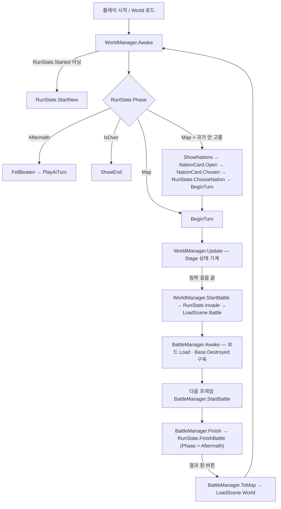
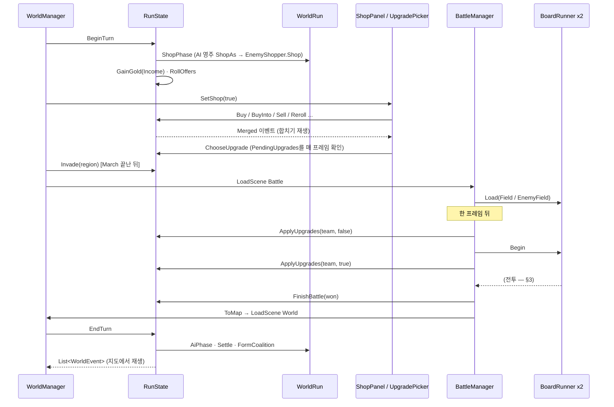
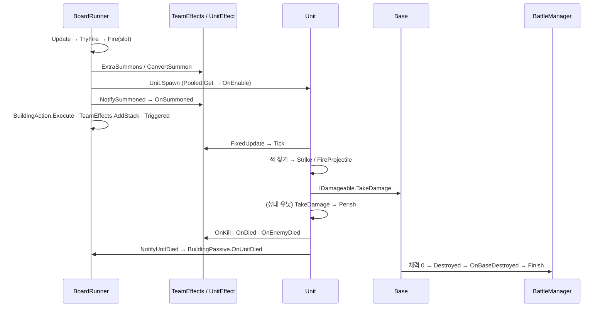
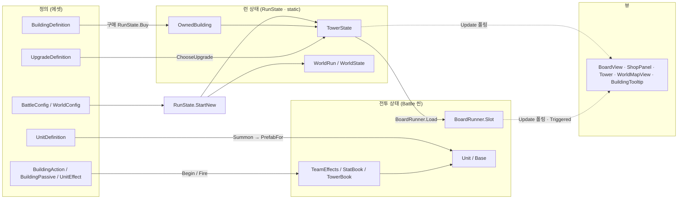

# CODE_FLOW.md — 런타임 코드 흐름

> **코딩할 때 보는 "무엇이 무엇을 부르나" 지도.** 폴더 책임·규칙·"X 추가하려면"은 [ARCHITECTURE.md](ARCHITECTURE.md),
> 씬에 놓인 오브젝트·배선은 [SCENE_MAP.md](SCENE_MAP.md)가 원본이다 — 여기엔 다시 적지 않는다.
>
> **적는 것**: 진입점 · 수명주기 순서 · 한 턴의 호출 순서 · 데이터가 SO → 런타임 → UI로 가는 길 · 이벤트 구독 · 확장 지점.
> **안 적는 것**: 수치 · 기물/유닛 목록 · 줄 번호(낡는다). 포인터는 전부 `클래스.메서드`다 — grep으로 찾을 것.
> 코드와 어긋나면 코드가 정답이다.

---

## 1. 진입점과 수명주기

### 씬과 빌드 순서
- 빌드 순서는 `ProjectSettings/EditorBuildSettings.asset`이 원본이다(지금 `World` → `Battle`). 플레이는 `World`에서 시작한다.
- 씬 전환은 전부 `SceneManager.LoadScene`(동기, 단일 모드) 네 곳뿐이다:
  - `WorldManager.StartBattle` → Battle (침략 걸음이 끝났을 때)
  - `BattleManager.ToMap` → World (결과 창의 버튼)
  - `BattleManager.Awake` → World (`Battle`만 직접 플레이해 `Phase`가 `Battle`이 아닐 때)
  - `WorldManager.Next` → World (런이 끝나 「새 런」 — `RunState.StartNew` 뒤 씬 재로드)

### static 상태 (씬이 바뀌어도 남는 것)
| 상태 | 수명 | 비우는 곳 |
|---|---|---|
| `RunState` (static class) | 런 한 판 | `RunState.StartNew`. 플레이모드 진입 때 `RunState.ResetStatics`(`[RuntimeInitializeOnLoadMethod(SubsystemRegistration)]`)가 `Started=false`로 |
| `RunState.World` (`WorldRun` → `WorldState`) | 런 한 판 | `StartNew`가 새로 만든다 |
| `TowerState` (내 탑 = `RunState.Player`, AI 영주 탑 = `WorldRun._towers`) | 런 한 판 | `TowerState.Reset` / `WorldRun.Settle`(사라진 영주) |
| `StatBook` · `TowerBook` | 「전투 동안」 목록 + 「영구히」 목록 | 전투: `BattleManager.StartBattle`의 `ClearBattle` · 영구: `StartNew`의 `ClearRun` |
| `RunBook` | 탑마다 하나 — 진영별 「지금 쓰는 탑」의 영구 목록을 `StatBook`/`TowerBook`에 꽂는다 | `RunBook.Use`로 교체(`RunState.Invade` · `BeginTurn` · `ShopAs`) |
| `TeamEffects` · `UnitAliases` | 전투 한 번 | `BattleManager.StartBattle` |
| `BoardRunner.ByTeam` · `Base.All` · `Ground.Instance` · `FxDirector.Instance` · `BattleManager._instance` · `WorldManager._instance` | 씬 하나 | 각자 `OnDestroy`/`OnDisable` |
| `Pooled.Free` | 앱 수명 — 씬 재로드 뒤 파괴된 항목은 `Pooled.Get`이 건너뛴다 | 없음 |

그 밖의 `RuntimeInitializeOnLoadMethod`: `Base.SetupLayers`(BeforeSceneLoad — 진영 레이어 충돌 무시), `LordPaint`·`SpeedButton`(SubsystemRegistration — static 초기화).

### 실행 순서가 걸린 곳
- `[DefaultExecutionOrder]`은 `Ground`(100 — `BattleManager.Awake`가 런·맵을 정한 뒤 땅을 만든다)와 `BackdropParallax`(200)뿐. 나머지는 기본 순서다.
- **Battle 씬 한 프레임 미뤄 연다**: `BattleManager.Awake`는 보드를 `Load`만 하고, `BeginNextFrame` 코루틴이 한 프레임 뒤 `StartBattle`을 부른다 — `Tower.Start`(보드의 `Triggered` 구독) · `Base.Start`(최대 체력 계산) 같은 다른 `Start`가 먼저 끝나게.
- `Base.Start`는 `RunState`(라운드에 따른 체력 보너스)를 읽으므로 `Awake`가 아니라 `Start`에서 계산한다. `Tower.Start`도 같은 이유(영주 색).
- `Time.timeScale`: 두 매니저의 `Awake`가 1로 되돌리고, `BattleManager.StartBattle`이 `SpeedButton.Current`로, `BattleManager.Finish`가 0으로.

---

## 2. 한 턴의 흐름

### World 씬 — `WorldManager`
`WorldManager.Update`가 `Stage`(`Choose` · `Command` · `March` · `Replay` · `Summary`)로 도는 상태 기계다. 규칙은 전부 `RunState`가 하고 `WorldManager`는 화면·순서만 맡는다.

1. **턴 열기** `WorldManager.BeginTurn` → `RunState.BeginTurn` — 턴당 한 번(`_shopEnteredRound`로 막는다). 지난 상대를 내려놓고 → `WorldRun.ShopPhase`(AI 영주마다 `WorldRun.Shop` → `RunState.ShopAs` → `EnemyShopper.Shop`) → 내 무료 리롤 충전 → `RunState.GainGold(Income)` → `RollOffers`. 이어서 `RunState.TakeShopCue`가 참이면 상점 팝업이 저절로 내려온다(`WorldManager.SetShop`).
2. **명령** — 땅 클릭(`WorldMapView.Clicked` → `WorldManager.Select`), 고른 땅은 매 프레임 `RunState.Preview`로 런 상태에 둔다(상점·패널이 같은 땅을 본다). 버튼: 「침략」 `Invade` · 「쉬기」 `Rest` · 「상점」 `Shop`.
3. **상점 팝업** `ShopPanel`(프리팹 `ShopPopup`) — 버튼·끌기가 `RunState.Buy`/`BuyInto`/`BuyInsert`/`MoveInsert`/`Swap`/`Sell`/`Reroll`/`RaiseFloor`/`ToggleShopLock`만 부른다. 「지도로」는 `ShopPanel.MapRequested` → `WorldManager.SetShop(false)`.
   - 진열 짐꾼 연출은 `OfferCard`가 상태 변화를 보고 스스로 한다 — 새 기물이면 왼쪽에서 걸어 들어옴(팝업이 `Settled`된 뒤), 비면(구매) 빈손 껍데기가 왼쪽으로 나감. 리롤은 `ShopPanel`이 `RunState.Reroll` 전에 `OfferCard.LeaveForReroll`(짐 든 껍데기가 오른쪽으로)을 부르고 `ExitLeft`(0.3초)를 건다 — 새 짐꾼은 `ExitLeft`가 0이 된 뒤 칸마다 늦게 들어온다(사용자 10/23: 다 나간 뒤 입장). 짐꾼 줄 가운데 = 무대 가운데(`ShopPanel` StageLeft·StageRight). 진열 글(이름 · 가격 · 잠김)은 `OfferCard`가 실행 중 `Labels`로 묶어, 짐꾼이 나가는 순간(리롤 `LeaveForReroll` · 구매) 숨기고 새 짐꾼이 도착하면 8px 아래서 2단으로 올린다(0.1초). 팔린 칸 「—」와 잠금 토글은 즉시.
   - 진열 클릭 구매는 `ShopPanel.BuyThrown` — `OfferCard.Jump`(짐꾼이 뛰었다 빈손으로 걸어 나감) → `RunState.Buy` → 합치기면 `MergeFx.Play(thrown: true)`(첫 비행이 던지기 포물선), 아니면 `MergeFx.Throw`(새 기물의 칸으로 계단식 포물선 0.3초, 나는 동안 그 칸은 `ShopPanel.Concealed`로 숨김). 끌어서 구매는 던지지 않는다(사용자 10/23). 걸음 계단은 `UI/UnitFigure.Step`(국가 선택 `NationCard`와 공용). 합치기 출발점 = `OfferCard.LoadPosition`.
   - 구매 → `RunState.FindMergeTarget`이 짝을 찾으면 `RunState.MergeInto`(연쇄 합치기) → `RunState.OfferUpgrade`(합치기 보상 후보를 `Pending`에 쌓는다, AI 탑이면 바로 얻는다) → `RunState.Merged` 이벤트 → `ShopPanel.OnMerged`가 `MergeFx`로 재생(조각 · 트레일 · 폭발은 캔버스 맨 위 연출 판, 후광은 내 탑 바로 뒤 판 — 둘 다 실행 중 만든다. 등급 연출은 재생 길이(`ShopPanel.MergePlaying`)와 따로 돌아 업그레이드 고르기 시점을 바꾸지 않는다).
   - 구매 공통 끝: `RunState.OnBought` → `BuildingPassive.TriggerBuyEffects`(「구매할 때마다,」) · 필드 기물의 `OnAnyBought`.
4. **업그레이드 고르기** `UpgradePicker.Update` — 이벤트가 아니라 **매 프레임 `RunState.PendingUpgrades`를 본다**. 대기가 있고 AI 턴 재생 중이 아니면 화면을 막고, `ShopPanel.MergePlaying` 동안은 카드 없이 막기만 한다. 카드 클릭 → `RunState.ChooseUpgrade` → `GainUpgrade`(`TowerState.Upgrades`에 추가). 침략 때 남은 대기는 `RunState.Invade`가 무작위로 고른다.
5. **침략** `WorldManager.Invade` → `Stage.March`, `WorldLords.March`로 내 영주가 걷는다 → `Update`에서 걸음이 끝나면(또는 시간 상한) `WorldManager.StartBattle` → `RunState.Invade`(상대 영주 · 그 탑 · `RunBook.Use(Enemy)` · `WorldRun.SyncSpecials` · 전장 맵 확정 · `Phase = Battle`) → Battle 씬.
6. **쉬기** `WorldManager.Rest` → `RunState.Rest`(`Phase = Aftermath`) → 곧바로 `PlayAiTurn`.

### Battle 씬 — `BattleManager`
7. `BattleManager.Awake` — `TowerBook.ClearBattle`, 두 `BoardRunner.Load`(`RunState.Field` · `RunState.EnemyField`), `Base.Destroyed` 구독.
8. `BattleManager.StartBattle`(다음 프레임) — 순서가 의미 있다:
   1. `TeamEffects.Clear` · `StatBook.ClearBattle` · `TowerBook.ClearBattle` · `UnitAliases.Clear`
   2. 맵 규칙(`MapDefinition.UnitRules` → `StatBook.AddForBattle` 양 진영)
   3. `RunState.ApplyUpgrades(team, false)` → `UpgradeDefinition.Apply` — 스탯 · 유닛 효과 · 지역 특수 플래그(`BoardRunner.ExtraSummons` 등)를 **보드가 돌기 전에**
   4. 두 `BoardRunner.Begin` — 칸의 `owned.Effects`를 `TeamEffects.Enable`, 이어서 패시브 `OnBattleStart`
   5. `RunState.ApplyUpgrades(team, true)` → `UpgradeDefinition.Spawn` — 소환 · 작은 타워 · 쿨다운처럼 **보드가 돈 뒤에** 할 것
   6. `_fighting = true`, `Time.timeScale = SpeedButton.Current`
9. 전투 루프는 아래 §3.
10. **끝 판정** — 두 길:
    - `Base.TakeDamage`에서 본진 체력 0 → `Base.Destroyed` → `BattleManager.OnBaseDestroyed` → `Finish`
    - `BattleManager.Update` — `BoardsStopped` 뒤에만, 살아 있는 유닛을 세어 데스매치·교착 판정 → `Finish`(규칙의 원본은 이 메서드의 주석). 교착 시계는 `BattleManager.NoteProgress`(`Unit.TakeDamage` · `Unit.Perish` · `Base.TakeDamage`가 부른다).
11. `BattleManager.Finish` — 두 보드 `Stop` → `RunState.FinishBattle(won)`:
    `WorldTurn.Invade`(판도 반영 — 지면 목숨 −1, 위기 중에 지면 바로 게임 오버) → 목숨이 1→0이 된 순간 `OfferCrisis`(국가 위기 — 지도에 안 놓인 지역 특수 셋, 건너뛰기 없음)를 `Pending`에 → `Phase = Aftermath` → `NotifyBattleWon`(승자 탑 필드의 `BuildingPassive.OnBattleWon`) → 멸망시킨 영주의 지역 특수 업그레이드를 `Pending`에 신화 후보로 → `ApplyBattleResult`(승패에 걸린 지역 특수).
    그다음 결과 창 + `timeScale = 0` → 버튼 → `BattleManager.ToMap`.

### 다시 World 씬 — AI 턴
12. `WorldManager.Awake`가 `Phase == Aftermath`를 보고 `FellBeaten`(쓰러진 영주 연출) → `PlayAiTurn` → `RunState.EndTurn`:
    `Phase = Map` → `WorldRun.AiPhase`(영주마다 `WorldTurn.AiInvade` — 승패는 `TowerPower` 전투력 주사위, 전투 씬 없음) → 반란 기록 → `WorldRun.Settle`(행복도·반란은 AI 영주만) → `WorldRun.FormCoalition` → `Round++`. 사건 목록(`WorldEvent`)을 돌려준다.
13. `WorldManager.Schedule` → `Update`의 `Stage.Replay`가 사건을 시각대로 `WorldLords.March` · `WorldEvent.Apply(_shown)`으로 재생 → `FinishReplay`(요약) → 「다음 턴」 `Next` → `BeginTurn`. 통일·게임 오버(`RunState.IsOver`)면 `ShowEnd`.

---

## 3. 전투 한 프레임 — 기물 발동에서 본진 피해까지

- **`BoardRunner.Update`**(진영마다 하나): `_running`이고 `!BattleManager.BoardsStopped`일 때만. `Revive` → 칸마다 `Frozen` 처리 또는 `Timer` 증가(가속·맵 배율) → `TryFire`(칸당 한 프레임 한 번 — `Slot.FiredThisFrame`) → 단두대 · 맵 「전부 발동」 타이머.
- **`BoardRunner.Fire`** — 반복 수(맵 · 물레방앗간 신화 · 군주제)만큼: ① `definition.Unit`이 있고 어떤 액션도 `ReplacesSummon`하지 않으면 `Summon` ② `owned.Actions` 각각 `Execute` ③ `owned.Effects` 각각 `TeamEffects.AddStack`. 끝에 `Triggered` 이벤트 · `BuffLinks.SlotFired`.
- 즉시 발동은 `BoardRunner.FireNow`(게이지 그대로) — 액션 · 패시브 · 유닛 효과(`FireOwners`)가 부른다.
- **`BoardRunner.Summon`** = 이 진영 모든 소환의 입구: 켜진 효과의 `ExtraSummons` → `ConvertSummon` → 자리 결정(작은 타워 · 탑 층 · 성문) → 한 마리마다 `Unit.Spawn`/`Unit.SpawnStanding`(→ `Pooled.Get`) → `OnConverted` → `Unit.NotifySummoned`(효과 `OnSummoned`) → 다른 칸 패시브 `OnSummonedFrom`.
- **`Unit`** — `OnEnable`이 한 생애의 상태를 전부 되돌린다(풀 재사용). 매 물리 스텝 `Unit.FixedUpdate`: 경직·넉백 → 효과 `Tick` → 회복 유닛 분기 → `FindTargetCached`로 적이 있으면 공격 분기(`AttackType`별 — `Strike` · `FireProjectile` · `BreatheFire` · `Sweep`), 없으면 뒤돌아 싸움(병종의 `UnitCategory._turnBack`이 켜져 있고 땅을 딛고 서 있을 때, 등 뒤 `BattleConfig._turnBackRange`칸 안의 적 유닛 쪽으로 걷는다 — 이 스텝은 뒤로 못 가는 래칫 `HoldBack`을 끈다) → 그것도 없으면 전진·등반. 떨림 방지: 찾은 적은 `BattleConfig._targetHold` 동안 붙잡는다(죽음·발밑·사거리 밖이면 바로 다시 찾음), 뒤돌기는 `_turnBackRange` 안에서 들어가고 `+ _turnBackExit` 밖에서 그만두며(그만둔 뒤 `_targetHold` 동안 다시 안 돎), 앞을 보고 싸우는 아군이 그 적과 나 사이에 있으면 돌아서지 않는다(10/21). 그림 연출은 `Unit.Update`.
- **피해** `Projectile.Deal`(타워 화살이 건물을 맞히면 ×`BattleConfig._towerVsBuildingDamage`) → `Unit.TakeDamage` · `Base.TakeDamage` → 실제로 깎인 몫을 `Battle/DamageMeter.Credit`(공격자의 출처 칸 `Unit.SourceSlot` · 타워 · 기타 — 결과 창 딜 미터기, `BattleManager.StartBattle`에서 비움) → (무적이면 반사만) → 체력 감소 · `NoteProgress` · 반사 · 때린 쪽 `OnDealtDamage` → 0 이하면 첫 죽음 보호 효과 → `Unit.Perish`. 살아 있으면 효과 `OnHit` → 밀림.
- **죽음** `Unit.Perish`: 부활 확률 → `Die`(충돌 끄기 · 시체 연출, 시간이 지나면 `SetActive(false)`로 풀에 반납) → 두 진영 보드 `BoardRunner.NotifyUnitDied`(패시브 `OnUnitDied` — 누가 죽였든) → 처치자 진영 효과 `OnKill` 또는 타워 처치면 `Base.NotifyKill` → `BoardRunner.NotifyTowerKill`(칸 패시브 — 예: 주식시장 `TowerKillGoldPassive` → `RunState.GainBattleGold` + `GoldDrops.Raise` → 뷰 `Fx/GoldCoinFx` · `UI/BattleGoldView`, 스팀바론 `TowerKillBuyPassive` → 「구매할 때마다,」 발동 경로) → 내 진영 `OnDied` → 상대 진영 `OnEnemyDied`.
- **본진** `Base.FixedUpdate`: 쏠 수 있으면(`CanAttack`) `FindTargets` → `Base.Shoot` → `Projectile`. `Base.TakeDamage`: 작은 타워면 `NotifySmallTowerDestroyed` 후 `Destroy`, 본진이면 `SetActive(false)` + `Destroyed`.
- 스탯은 매번 계산하지 않는다 — `Unit`·`Base`가 `StatBook.Version`·`TowerBook.Version`이 바뀌었을 때만 다시 읽는다(`Unit.RefreshStats` · `Base.RefreshStats`).

---

## 4. 데이터 흐름 — 정의(SO) → 런타임 상태 → 뷰

| 층 | 무엇 | 바뀌는가 |
|---|---|---|
| **정의 (ScriptableObject)** | `BattleConfig`(전투·상점·풀·업그레이드 목록 — `WorldConfig`를 품는다) · `WorldConfig`(지도·영주) · `BuildingDefinition` · `UnitDefinition` · `UpgradeDefinition` · `MapDefinition` · `BaseDefinition` · 능력 SO(`BuildingAction` · `BuildingPassive` · `UnitEffect`) | 런타임에 값을 쓰지 않는다(능력 SO의 진영별 계수 배열 예외 — 아래) |
| **런 상태 (순수 C#)** | `TowerState`(골드 · `Field` · `Storage` · `Offers` · `Upgrades` · `Book`) · `OwnedBuilding`(정의 + 오른 횟수 · 스택 · 쓴 골드) · `WorldState`/`Lord` | 상점·턴 규칙(`RunState`)만 바꾼다 |
| **전투 상태** | `BoardRunner.Slot`(칸 게이지 · 가속 · 정지) · `TeamEffects.Entry`(켜진 효과 · 스택 · 등급) · `StatBook`/`TowerBook`의 전투 목록 · `Unit`/`Base` 인스턴스 | 전투 씬 안에서만 |
| **뷰 (UI)** | `BoardView`/`SlotView`/`Tower`(탑) · `ShopPanel`/`OfferCard` · `WorldMapView`/`WorldSidePanel`/`WorldLords` · `BuildingTooltip` · `UpgradePicker` | **대부분 `Update`에서 상태를 읽어 그린다**(폴링) — 순간 연출만 이벤트(§5) |

- 기물에 켜진 능력은 `owned.Actions/Effects/Passives`로 읽는다(신화 묶음 합본 — 이유는 ARCHITECTURE 「자주 헷갈리는 것」).
- 등급 → 수치: `OwnedBuilding.Level`(수치용) · `OwnedBuilding.CooldownLevel` → `BuildingDefinition.CooldownAt`. 능력 SO는 `Execute(board, slot, level)`/`Describe(level)`로 등급을 받아 스스로 키운다(`OwnedBuilding.Scaled`).
- `BoardView`는 전투 중엔 `BoardRunner.For(team).Slots`, 지도 씬(상점)에선 `RunState.Field`/`Storage`를 읽는다(지도 씬엔 `BoardRunner`가 없다).
- 툴팁 글은 능력 SO의 `Describe`가 지금 등급 값으로 만든다 — `BuildingTooltip`이 모아 칠한다. 글 규칙은 CLAUDE.md §5-2.
- 🔴 **능력 SO는 에셋 하나를 그 능력을 쓰는 모든 기물·양 진영이 같이 쓴다.** 전투 중 셀 값이 필요하면 진영별 배열(`[(int)team]`)로 두고 `OnBattleStart`나 전투 시각으로 되돌린다 — 예: `DeathCountCooldownPassive._count`, `PeriodicBattleStatEffect._applied`.

---

## 5. 이벤트 · 콜백 연결

| 이벤트 (발행) | 구독 | 용도 |
|---|---|---|
| `Base.Destroyed` | `BattleManager.Awake` | 본진 파괴 → 전투 끝 |
| `BoardRunner.Triggered(int slot)` | `BoardView.Start` · `Tower.Start` | 칸 발동 반짝임·튐 |
| `OwnedBuilding.EffectFired` (static) — `OwnedBuilding.NotifyEffect`로 발행 | `BoardView.Start` · `Tower.Start` | 쿨다운 밖 효과(구매 · 전투 시작 · 상점 훅)의 튐 |
| `BuffLinks.Raised` (static) | `BuffLinkFx.OnEnable`(전장 선) · `BoardView.Start`(세로 탑만, UI 선) | 버프 선 |
| `RunState.Merged` (static) | `ShopPanel.OnEnable` | 합치기 단계별 재생(상태는 이미 끝난 뒤) |
| `RunState.UpgradesChanged` (static) | 지금 구독자 없음 — `UpgradePicker`는 폴링 | — |
| `NationCard.Chosen` (국가) | `WorldManager.ShowNations` | 「시작」을 누르면 `RunState.ChooseNation` → `BeginTurn` — 카드(뷰)는 상태를 바꾸지 않는다 |
| `ShopPanel.MapRequested` | `WorldManager.Awake` | 상점 닫기 |
| `WorldMapView.Clicked(int region)` | `WorldManager.Awake` | 땅 고르기 |
| uGUI `onClick` | `WorldManager.Awake`(침략 · 쉬기 · 상점 · 건너뛰기 · 다음) · `BattleManager.Awake`(결과 버튼) · `ShopPanel.Start` · `SpeedButton.Awake` | 버튼 |

이벤트가 아닌 **직접 호출 훅**(구독 없이 부르는 쪽이 대상을 찾는다): `BoardRunner.NotifyUnitDied`/`NotifyTowerKill`/`NotifySmallTowerDestroyed` → 칸 패시브, `TeamEffects.For(team)` 순회 → `UnitEffect` 가상 메서드, `BattleManager.NoteProgress`, 상점 훅(`RunState`가 필드 패시브의 `OnBuy`/`OnAnyBought`/`OnReroll`/`OnSell`/`OnGoldGained`를 직접 부른다).
- 🔴 static 이벤트를 구독하면 반드시 `OnDestroy`/`OnDisable`에서 푼다 — 씬이 바뀌어도 이벤트는 남는다(지금 구독자들이 다 그렇게 한다).

---

## 6. 기물 효과 확장 지점

무엇을 어디 붙이는지(에셋 쪽 절차)는 ARCHITECTURE 「X 추가하려면 어디 봐야 하나」가 원본이다. 여기엔 **코드에서 누가 언제 부르는지**만.

| 만들 것 | 상속 | 불리는 곳 | 실제 예시 |
|---|---|---|---|
| 쿨다운 발동 효과 | `BuildingAction` — `Execute(board, slot, level)` · `Describe(level)` 필수 | `BoardRunner.Fire`(칸 발동마다, 반복 수만큼). `ReplacesSummon`은 소환 직전에 | `Assets/Scripts/Buildings/AddBattleStatAction.cs`(진영 스탯) · `Assets/Scripts/Buildings/HasteNeighborsAction.cs`(이웃 칸 — `Reaches`/`UsesAdjacency`도 덮는다) |
| 늘 켜진 기물 능력 | `BuildingPassive` — 쓰는 훅만 덮고 `Describe(level)` 필수 | 전투: `BoardRunner.Begin`(`OnBattleStart`) · `Summon`(`OnSummonedFrom`) · `Notify*`. 상점: `RunState`의 구매·리롤·판매·골드 · `FinishBattle`(`OnBattleWon`) | `Assets/Scripts/Buildings/SummonAtStartPassive.cs`(전투 시작) · `Assets/Scripts/Buildings/DeathCountCooldownPassive.cs`(죽음 훅 + 진영별 카운터) |
| 유닛에게 거는 진영 효과 | `UnitEffect` — 쓰는 훅만 덮는다. 대상은 에셋의 병종/유닛 칸(`AppliesFor`) | `BoardRunner.Begin`이 `TeamEffects.Enable` → `Unit`·`BoardRunner`·`Base`가 `TeamEffects.For(team)`을 돌며 훅 호출 | `Assets/Scripts/Units/Effects/DeathSummonEffect.cs`(`OnDied` → `BoardRunner.Summon`) · `Assets/Scripts/Units/Effects/PeriodicBattleStatEffect.cs`(`Tick` → `StatBook.AddForBattle`) |
| 유닛이 늘 갖는 효과 | 같은 `UnitEffect`를 유닛 정의 `UnitDefinition._innateEffects`에 단다(`_traitEffects`는 표시 전용 — 켜는 것은 기물) | `Unit.OnEnable`(풀에서 나올 때 — 어느 기물·효과로 나오든)이 `TeamEffects.Enable` | `Assets/Data/Units/Unit_Minotaur.asset`(고도 효과) |
| 전장 연출(시각 피드백) | `Fx/<부품>` 정적 진입점 — `ArrowTrails.Follow` · `AltitudeMark.Watch`(고도 배율 「×1.4」 + 몸 둘레 빨간 입자 — 고도 원판은 10/23 폐지) · `DustFx.Burst` · `Trail`(유닛 사망 먼지 — 월드맵 영주 먼지와 같은 동그란 구름, `FxDirector.Corpse`가 터뜨리고 `CorpseFx`가 시체 꼬리를 남김, 상한 600 · 같은 자리 0.15초 솎기 — 10/23) · `HoverMark.Show`(UnitHover가 고른 유닛 둘레 꺾쇠 — UnitHover는 0.1초마다 OverlapCircle 한 번으로 고르고 Unit을 읽기만) · `HealFx.Received`(`Unit.Heal` · `Base.HealRatio`가 부름 → 회복 오브 → 닿으면 숫자 + 초록 십자) · `RingFx.Pulse` · `StatusDots.Watch` · `PillarFx` · `FloorMultiplier.Show` (부품마다 관리자 하나 · 메시 하나(`Fx/PixelMesh`) · 동시 상한 · 솎기, 투사체마다 컴포넌트 금지) | 게임 코드는 그 순간 한 줄만 부르고, 그다음은 부품이 상태(`Unit.IsBurning` 등)를 읽기만 한다. 생성은 `FxDirector`. 여러 발 화살은 `Units/Volley`가 짧은 시차로 연달아 쏜다(갈래 연출은 10/22에 폐지). 기물이 직접 준 피해(뼈 투척 등)는 `Core/SlotAttacker`로 그 칸 몫. 데스매치 직전 훅 `BuildingPassive.OnBeforeDeathmatch`(`BoardRunner.Update`, `_preDeathmatchSeconds` 전 한 번). 소환 기둥(`PillarFx`)은 `BoardRunner.Summon`에서 그 자리 소환 · 추가 소환 · 변환으로 나온 기에만. 버프 선의 출발점은 칸 · 유닛 자리 · 본진(`BuffLinks.FromBase`) · 임의 지점(`FromPoint`). 반복 버프 글자는 `BuffTexts`가 같은 자리 · 같은 종류면 값을 합쳐 한 줄로 | 계획·부품 정의는 `Docs/전투시각화_계획.md` |
| 지형 연출 | `Fx/TerrainFx`(맵 종류 = `MapDefinition.Look`) — 판이 열린 첫 프레임에 땅 장식, 그 뒤 하늘 입자 · 탑 창 표시를 매 프레임. 「전부 발동」 같은 순간은 `BoardRunner.MapFiredAll(Team)` 정적 이벤트를 구독(OnDestroy에서 해제). 시작 배너 `UI/TerrainBanner`는 `BattleManager.Fighting`이 처음 켜질 때 맵 이름 + `MapDefinition.Description` | 새 지형을 넣으면 `TerrainLook` 값 하나 + `TerrainFx`의 그리기 분기 | `Assets/Data/Maps/Map_Ice.asset` |

- 효과 안에서 쓰는 보드 조작: `BoardRunner.Summon` · `FireNow` · `FireLongest` · `Haste`/`HasteRandom`/`HasteAll` · `ScaleCooldown` · `Freeze` · `AddBattleGain`. 스탯: `StatBook.AddForBattle`/`AddForRun` · `TowerBook`.
- 연출: 다른 대상에게 효과를 주면 `BuffLinks.*`로 선을 긋고, 쿨다운 밖에서 터진 기물은 `OwnedBuilding.NotifyEffect`.
- `UnitEffect`가 등급·출처·업그레이드 값을 읽는 길: `Level(team)` · `Source(team)` · `Value(team)`(전부 `TeamEffects.Entry`에서).
- **새 훅이 필요하면** 베이스 클래스에 가상 메서드를 하나 더하고, 그 사건이 일어나는 한 곳(`Unit`의 해당 메서드 · `BoardRunner`)에서 `TeamEffects.For` 또는 칸 패시브를 돌며 부른다 — 기존 훅들이 모두 이 모양이다.
- 각 클래스는 `[CreateAssetMenu(menuName = "GnorpWar/Actions|Passives|Effects/…")]`로 에셋을 만든다.
